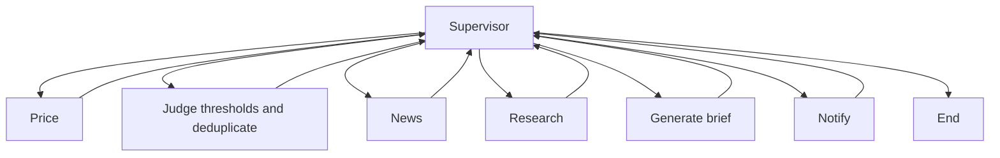

# Stock Monitor Agent

A Python stock-monitoring assistant built with LangGraph, yfinance, and OpenAI-compatible model APIs. It tracks price moves, gathers company news and research, and delivers contextual reports to the console or Discord.

Two execution modes share the same data and report-generation functions:

| | Workflow mode | Agent mode |
| --- | --- | --- |
| Best for | Recurring monitoring and daily briefs | One-off research requests |
| Entry point | `main_workflow.py` | `main_agent.py` |
| Control flow | Explicit LangGraph state and rule-based routing | LLM-selected tool calls through LangChain `create_agent` |
| Input | `config.yaml` and `watchlist.yaml` | An interactive natural-language prompt |
| Scheduling and alert deduplication | Built in | Not provided |

## Features

- **Per-ticker monitoring:** configure price-change thresholds, intraday participation, and research independently.
- **Daily and intraday reports:** cover the full watchlist in daily briefs; research only newly triggered tickers during intraday checks.
- **Market context:** compare each move against SPY and QQQ.
- **Company research:** collect relevance-filtered news, recent SEC 8-K / 6-K filings and available EX-99.1 excerpts, earnings dates, analyst consensus, targets, estimates, and rating changes.
- **Relative volume:** compare today's volume with the expected volume at the same time of day, using recent trading history.
- **Grounded report prompts:** separate facts from analyst opinions, request source links, and explicitly acknowledge missing catalysts.
- **Natural-language watchlist editing:** turn requests into validated add/update/remove operations, preview the diff, and confirm before saving.
- **Hot reload:** pick up watchlist edits on the next check; retain the last valid watchlist if a later edit is invalid.

## Quick start

Use **Python 3.10+** and run commands from the repository root so relative configuration and prompt paths resolve correctly.

### 1. Install dependencies

```bash
python -m venv .venv
source .venv/bin/activate
python -m pip install -r requirements.txt
```

On Windows PowerShell, activate with `.venv\Scripts\Activate.ps1`.

### 2. Configure the model

Create `.env` in the repository root. Both execution modes support endpoints implementing the **OpenAI-compatible Chat Completions API**. Choose one configuration below and restart the process after changing it.

**OpenRouter (default; existing configurations still work):**

```dotenv
OPENROUTER_API_KEY=your-openrouter-api-key
# Optional: select another OpenRouter model
# LLM_MODEL=your-model-id
```

The repository defaults to `nvidia/nemotron-3-ultra-550b-a55b:free`, followed by `google/gemma-4-31b-it:free` and `openrouter/free`. These are code defaults, not a guarantee of provider availability. Select an available model from [OpenRouter](https://openrouter.ai/models).

**Another API provider:**

```dotenv
LLM_BASE_URL=https://your-provider.example/v1
LLM_API_KEY=your-provider-api-key
LLM_MODEL=your-provider-model-id
# Optional: models available through this same endpoint and key
LLM_FALLBACK_MODELS=
```

Replace the example URL with your provider's API base URL, not the full `/chat/completions` URL. A service with a different native API requires an OpenAI-compatible gateway or a separate adapter.

**Your own local or self-hosted model:**

```dotenv
LLM_BASE_URL=http://localhost:8000/v1
LLM_API_KEY=local
LLM_MODEL=your-served-model-name
LLM_FALLBACK_MODELS=
```

Start your model server separately and use its actual base URL and served model name. `local` is a non-secret placeholder required by the SDK for a server without authentication; use the real server key if authentication is enabled. This project connects to an inference server; it does not load model weights itself.

| Variable | Behavior |
| --- | --- |
| `LLM_BASE_URL` | Defaults to `https://openrouter.ai/api/v1` |
| `LLM_API_KEY` | Generic API key used by both Workflow and Agent modes |
| `OPENROUTER_API_KEY` | Legacy fallback key, used only for the default OpenRouter endpoint when `LLM_API_KEY` is unset |
| `LLM_MODEL` | Required for custom endpoints; defaults to the repository's model on OpenRouter |
| `LLM_FALLBACK_MODELS` | Comma-separated model IDs on the same endpoint; empty disables fallbacks |

Custom endpoints have **no automatic OpenRouter fallback models**, and never receive the legacy `OPENROUTER_API_KEY`. All fallback requests stay on the configured endpoint. Agent mode requires a model/server that supports tool calling; report generation and watchlist parsing use text completions. The fallback chain covers reports and parsing, not the Agent's tool-selection loop.

### 3. Create local configuration

```bash
cp config_example.yaml config.yaml
cp watchlist_example.yaml watchlist.yaml
```

**For a first run, change `notify_method` to `console` in `config.yaml`.** The example uses Discord with placeholder credentials. For Discord delivery, set a real `discord.webhook_url`; `discord.mention_id` is optional.

To enable SEC filings, replace the example `sec.user_agent` with your name and contact email, or set `SEC_USER_AGENT` in `.env`. Without either value, filings are skipped.

### 4. Generate a report

```bash
python main_workflow.py --once daily
```

This runs immediately and exits. On a non-trading day or before today's price bars are available, current prices may be `N/A`.

To keep monitoring on the configured schedule:

```bash
python main_workflow.py
```

The process must remain running. Stop it with `Ctrl+C`.

## Configuration

### Global settings: `config.yaml`

The workflow loads its settings once at startup; restart it after changing them. The following defaults are from `settings.py`; the supplied example enables intraday checks and Discord explicitly.

| Key | Default | Meaning |
| --- | --- | --- |
| `timezone` | `America/Toronto` | Timezone for market hours and scheduled runs; use an Eastern Time zone |
| `schedule.daily_brief` | `"16:10"` | Daily report time (`HH:MM`); `null` disables it |
| `schedule.intraday_minutes` | `null` | Check interval from 1 to 390 minutes; `null` disables it |
| `notify_method` | `console` | `console` or `discord` |
| `report_language` | `zh` | `en`, `zh`, or `jp` |
| `defaults.alert_threshold` | `5.0` | Absolute percentage move versus previous close required for an alert |
| `defaults.intraday` | `true` | Include a ticker in intraday checks |
| `defaults.research` | `true` | Fetch news, filings, analyst views, and relative volume |
| `discord.webhook_url` | Unset | Required when `notify_method` is `discord` |
| `discord.mention_id` | Unset | Optional Discord user ID to mention |
| `sec.user_agent` | Unset | SEC client identity; `SEC_USER_AGENT` takes precedence |

At least one schedule must be enabled, including when using `--once`. Quote times in YAML, and use YAML booleans (`true` / `false`) for switches.

### Per-ticker rules: `watchlist.yaml`

```yaml
tickers:
  - symbol: MSFT
  - symbol: NVDA
    alert_threshold: 3.0
  - symbol: SPY
    intraday: false
    research: false
```

Omitted fields inherit `defaults` from `config.yaml`. Thresholds are percentages: `3.0` means 3%, not 0.03%. Use Yahoo Finance symbols, such as `BRK-B` for Berkshire Hathaway Class B.

`intraday: false` excludes a ticker from intraday checks but keeps it in daily briefs. `research: false` keeps its price snapshot and skips its news, filings, analyst data, and relative volume.

## Usage

### Workflow commands

```bash
# Run on the configured schedule
python main_workflow.py

# Run immediately, then exit
python main_workflow.py --once daily
python main_workflow.py --once intraday

# Use alternative configuration and watchlist files
python main_workflow.py --config my_config.yaml --watchlist my_watchlist.yaml
```

`--once` bypasses the trading-day scheduler. Intraday runs still use the same alert rules and persisted deduplication state.

### Edit the watchlist

```bash
python watchlist.py list
python watchlist.py "Add AMD and NVDA; alert me at 3% for NVDA"
python watchlist.py "把 NVDA 的阈值改成 4%，移除 AMD"
python watchlist.py "Disable intraday checks and research for SPY"
```

Each edit is parsed by the LLM, validated against the current watchlist, and displayed as a diff. Newly added tickers must also have price data available through yfinance. Confirm with `y` to write the file, or pass `--yes` to skip confirmation:

```bash
python watchlist.py "Add META" --yes
```

The CLI also accepts `--config` and `--watchlist`. You can edit the YAML manually; subsequent CLI writes preserve rules but replace comments. Listing or manually editing the watchlist does not require an LLM call.

### Interactive Agent

```bash
python main_agent.py
```

Enter a request when prompted, for example:

```text
分析 MSFT、NVDA 和 META，结合新闻、SEC 公告和分析师观点，用中文输出到 console。
```

For Discord delivery, explicitly request it and configure the webhook in `config.yaml`. The Agent processes one request, prints its final response, and exits. It does not start the scheduler or edit the watchlist.

## Architecture and AI design

### Workflow: deterministic orchestration

`main_workflow.py` builds a `StateGraph(AgentState)`. The supervisor inspects completed state fields and routes to the next unfinished node. **The supervisor does not call an LLM.** Business nodes return to it after each step.



Normal execution order is `price → judge → news → research → brief → notify`. For an intraday check with no new alerts, execution ends after `judge`, avoiding research and report-generation calls.

The graph state carries settings, ticker rules, the run kind, snapshots, news, research, alerts, and the generated brief. Each run uses a new thread ID. `MemorySaver` checkpoints are in memory; persistent alert history is stored separately in `state/alerts.json`.

### Agent: model-directed tool use

`main_agent.py` uses LangChain's `create_agent` and a `ChatOpenAI` client pointed at the configured model endpoint. The model chooses tool calls and when to finish.

| Tool | Responsibility |
| --- | --- |
| `ticker_price` | Fetch a ticker's price snapshot and percentage change |
| `ticker_news` | Fetch recent company-relevant news |
| `ticker_research` | Fetch analyst views, SEC filings, and relative volume |
| `generate_report` | Add market benchmarks and generate a grounded ticker report |
| `send_notification` | Deliver report text to console or Discord |

The system prompt asks the Agent to gather price, news, and research before generating a report and to send each ticker's report separately. These are model instructions, rather than enforced workflow transitions.

### Shared report generation

Both modes reuse `core.py` to assemble source data into text context, separating **facts** from **analyst opinions**. `prompt_manager.py` renders the YAML prompts in `prompts/`; the report LLM receives that context to explain the observed moves.

There are three distinct LLM responsibilities: parsing watchlist edits, composing reports, and selecting tools in Agent mode. Price calculations, threshold decisions, scheduling, and watchlist validation are ordinary Python logic.

## Scheduling and alert behavior

- Scheduled runs skip weekends and standard full-day NYSE holidays. Intraday checks run every configured interval from 09:30, plus a check at 16:00, in the configured timezone.
- Daily briefs cover every watchlist ticker, even when none crosses a threshold. If daily thresholds are exceeded, an `[ALERT]` notification is sent separately from the `[DAILY BRIEF]`.
- Intraday checks send an `[INTRADAY ALERT]` with a brief covering only newly triggered tickers. Quiet checks send nothing.
- If both run types are due together, intraday runs first. Runs execute sequentially.
- A threshold is **strictly exceeded**: with a 5% threshold, exactly ±5% does not trigger. Once eligible, moves are grouped by `floor(abs(change_pct) / threshold)`.
- Intraday deduplication tracks the highest delivered level per ticker, day, and direction. For example, +5.1% alerts once; +7% stays quiet; +10% alerts at the next level. Negative moves have separate levels.
- Intraday state is saved only after successful alert delivery. A failed send leaves the alert eligible for a later check if it still qualifies. Daily alerts do not use this deduplication store.

## Failure handling and current limits

| Situation | Current behavior |
| --- | --- |
| Invalid watchlist at startup | Fail immediately with a configuration error |
| Invalid watchlist after startup | Keep the last valid rules and report the error; changed errors can be reported again |
| Report/parser model rate limit, selected server error, or connection failure | Retry once on the same model, then try configured fallback models |
| Model timeout or other non-retryable error | Move to the next model without the same-model retry |
| All report models fail or return empty content | Deliver raw context with an “LLM unavailable” note |
| Watchlist parser cannot produce valid operations | Reject the edit; leave the file unchanged |
| Scheduled run raises an exception | Log the traceback and continue scheduling future runs |
| Long Discord message | Split into chunks of at most 2,000 characters |

The fallback chain applies to `llm_interaction.ask_llm`, used by report generation and watchlist parsing. **The Agent's tool-selection model does not use that fallback chain.**

Other implementation boundaries:

- Prices come from Yahoo Finance bars, not a streaming exchange feed. Missing or delayed data can produce `N/A`; generated explanations depend on the sources available.
- Market hours are fixed at 09:30–16:00. Early closes, exceptional exchange closures, and other markets' calendars are not handled. Changing `timezone` does not convert these fixed hours from Eastern Time.
- SEC requests read `SEC_USER_AGENT` or the default `config.yaml` directly. A workflow `--config` override does not change the SEC configuration path. Agent notifications also read the default `config.yaml`.
- Agent mode does not automatically apply workflow watchlist rules, report language, or notification preferences; state your requirements in the prompt.
- A missed schedule is not replayed as a backlog. After a run completes, the scheduler finds the next future slot.
- There is no brokerage integration, order execution, portfolio accounting, or backtesting engine.

## Development

Install pytest separately from the runtime dependencies, then run the unit tests:

```bash
python -m pip install pytest
python -m pytest -q
```

Tests cover configuration validation, watchlist edits and reloads, scheduling, alert deduplication, data processing, LLM fallback behavior, notification splitting, and workflow/Agent tools. They use mocks for external services; passing tests does not verify live provider availability.

| File | Responsibility |
| --- | --- |
| `main_workflow.py` | LangGraph state, nodes, routing, and workflow CLI |
| `monitor.py` | Trading calendar, scheduling loop, persistent intraday alert state |
| `main_agent.py` | Interactive tool-calling Agent and tool definitions |
| `core.py` | Shared snapshots, thresholds, context assembly, report generation |
| `settings.py` | Configuration validation, ticker rules, atomic writes, hot reload |
| `watchlist.py` / `parser.py` | Watchlist CLI and LLM-to-operation parsing |
| `ticker_checker.py` | Price data and relative volume |
| `news_collector.py` | News retrieval, relevance filtering, article excerpts |
| `analyst.py` / `filings.py` | Analyst and earnings data; SEC filings and press release excerpts |
| `llm_interaction.py` | OpenAI-compatible client, shared model configuration, retry and fallback logic |
| `prompt_manager.py` / `prompts/` | Prompt rendering and report/Agent instructions |
| `notifier.py` | Console and Discord delivery |
| `tests/` | pytest suite |

Local credentials (`.env`, `config.yaml`), personal watchlists, logs, and runtime state are ignored by Git. Keep real credentials out of the example files.

## Example output


## License

[Apache License 2.0](LICENSE).
