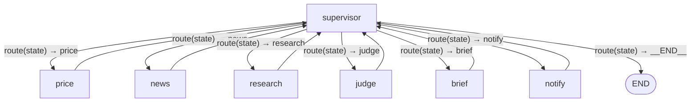
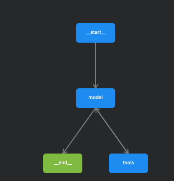
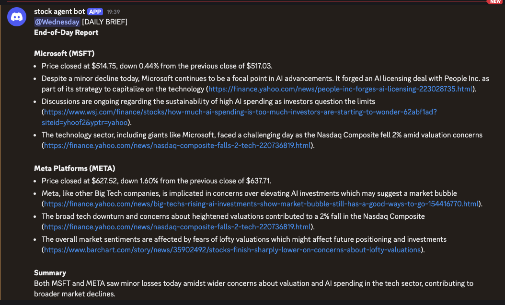

# Stock Monitor Agent 

A LangGraph-powered stock monitoring system that trace stock price, 
collect news and generate reports with workflow mode and agent mode.


### Workflow Mode
- Watches the tickers in `watchlist.yaml`, each with its own alert threshold and switches for intraday checks and research;
  edit it in natural language with `python watchlist.py "..."` and the running monitor picks up the change on its next check
- Runs intraday move checks and an after-close daily brief in the same process
- Fetches live prices and news via yfinance, keeping only stories actually about each ticker, with article summaries
- Compares each move with the market (SPY / QQQ) so the brief can tell stock-specific moves from market-wide ones
- Adds relative volume (today vs the usual volume by this time of day), recent SEC 8-K / 6-K filings with the
  opening of their EX-99.1 press release, and the next earnings date (facts), plus analyst consensus, price targets,
  EPS estimates and recent rating changes (opinions); the brief keeps facts and analyst views in separate sections
- Judges price movement thresholds
- Summarizes results using LLMs
- Sends notifications to Discord or console

Topology: 


### Agent Mode

- LLM agent parses user prompt itself
- LLM agent make use of tools provided to finish works from user requirements
- LLM agent decides when to end

Topology:




## Example

Edit the watchlist in natural language:

```bash
python watchlist.py "Watch MSFT and META, alert me at 3% for META"
```

Result:

---

## Setup

### 1. Install dependencies
```bash
pip install -r requirements.txt
```

### 2. Add your API key
Create a `.env` file in the project root with your [OpenRouter](https://openrouter.ai) key:
```
OPENROUTER_API_KEY=sk-or-your-key-here
# optional, defaults to nvidia/nemotron-3-ultra-550b-a55b:free
LLM_MODEL=nvidia/nemotron-3-ultra-550b-a55b:free
# optional, tried in order when the main model is rate-limited, down or retired; empty disables fallbacks
LLM_FALLBACK_MODELS=google/gemma-4-31b-it:free,openrouter/free
```
Rate limits, server errors and dropped connections are retried once on the same model before moving to the next one;
if every model fails, the brief falls back to the raw data. Free models change often: check
[OpenRouter's free models](https://openrouter.ai/models?max_price=0) if one starts failing.

### 3. Create `config.yaml`
Copy `config_example.yaml` to `config.yaml` and edit it. It holds the global settings and secrets and is read once at startup:
- `timezone`: market timezone, default `America/Toronto`
- `schedule.daily_brief`: `HH:MM` for the after-close brief, or `null` to turn it off (default `"16:10"`)
- `schedule.intraday_minutes`: check for moves every N minutes during market hours, or `null` to turn it off (default `null`)
- `notify_method` (`console` | `discord`) and `report_language` (`en` | `zh` | `jp`)
- `defaults`: per-ticker defaults — `alert_threshold` (percent, default 5.0), `intraday` and `research` (both default `true`)
- `discord.webhook_url` / `discord.mention_id`: needed for Discord notifications
- `sec.user_agent`: SEC requires automated clients to identify themselves with a contact (e.g. `"Your Name your-email@example.com"`);
  without it (or the `SEC_USER_AGENT` environment variable), filings are skipped

### 4. Create `watchlist.yaml`
Describe what to watch; the LLM turns it into add / update / remove operations, which are validated and shown as a diff before writing:
```bash
python watchlist.py "Watch MSFT, NVDA and SPY; alert me at 3% for NVDA; no intraday checks or news for SPY"
```
The file is plain YAML (see `watchlist_example.yaml`); each ticker can override `alert_threshold`, `intraday` and `research`.

---

## Usage

### Use Workflow Mode
Start the monitor; it keeps running and runs on the schedule in `config.yaml`. Stop it with Ctrl+C:
```bash
python main_workflow.py
```

Run a single daily brief, or a single intraday check, right now and exit:
```bash
python main_workflow.py --once daily
```
```bash
python main_workflow.py --once intraday
```

`--config` and `--watchlist` point at other files (defaults: `config.yaml`, `watchlist.yaml`).

Edit or show the watchlist while the monitor runs; the change applies on its next check, no restart needed:
```bash
python watchlist.py "add AMD, alert me at 4%"
```
```bash
python watchlist.py list
```
If an edit by hand breaks the file, the monitor keeps using the last valid watchlist and reports the error once.

Scheduling (runs on NYSE trading days only, skipping weekends and NYSE holidays, though early closes such as the day after Thanksgiving are not handled):
- **daily brief** (`schedule.daily_brief`): once per trading day at that time; covers every ticker and always sends.
- **intraday checks** (`schedule.intraday_minutes`): every N minutes from 09:30 open, plus once at 16:00 close, for tickers with
  `intraday: true`. They stay quiet unless a new alert fires, then send one `[INTRADAY ALERT]` message with the alert and a brief
  covering only the tickers that triggered.
- Both can be on at once; when they fall at the same time, the intraday check runs first.
- Tickers with `research: false` get prices only: no news, SEC filings, analyst views or relative volume.

Alert dedup: a ticker alerts once per day per direction, and again only when its move crosses the next
multiple of that ticker's threshold (with 5%: at 5%, then 10%, ...). State lives in `state/alerts.json`, so restarts don't re-alert. An alert is recorded only after it was delivered,
so a failed Discord send is retried on the next check.


### Use Agent Mode

Run the main entry:
```bash
python main_agent.py
```

Example prompt (inside `main_agent.py`):
```python
init = {
    "requirement": "分析 MSFT, NVDA 和 META, 并在discord给我发简报"
}
```


---

## Project Structure
```
main_workflow.py    # LangGraph workflow definition and monitor CLI
monitor.py          # Scheduling (intraday checks + daily brief) and alert dedup store
settings.py         # Load and validate config.yaml and watchlist.yaml, hot-reload the watchlist
watchlist.py        # CLI: show the watchlist or edit it in natural language
main_agent.py       # LangGraph agent definition
core.py             # Shared logic for both modes: prices, context, brief, config
parser.py           # Turn a natural-language request into watchlist edit operations (LLM)
ticker_checker.py   # Fetch stock prices, compute change and relative volume
news_collector.py   # Recent, relevance-filtered news with article summaries
analyst.py          # Analyst consensus, price targets, rating changes, earnings date (yfinance)
filings.py          # Recent SEC 8-K / 6-K filings and their press releases (EDGAR)
llm_interaction.py  # Interface with LLMs via OpenRouter (OpenAI-compatible API)
notifier.py         # Send Discord or console notifications
tests/              # pytest unit tests
```

---

## Acknowledgements
- [LangGraph](https://python.langchain.com/docs/langgraph)
- [yfinance](https://github.com/ranaroussi/yfinance)
- [OpenRouter](https://openrouter.ai)

---

## License
Apache 2.0

