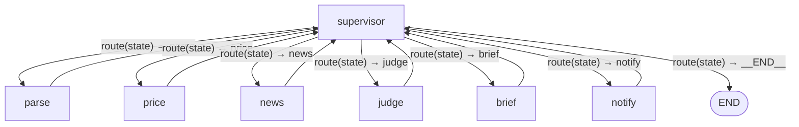
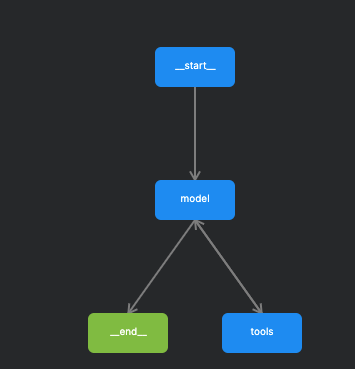
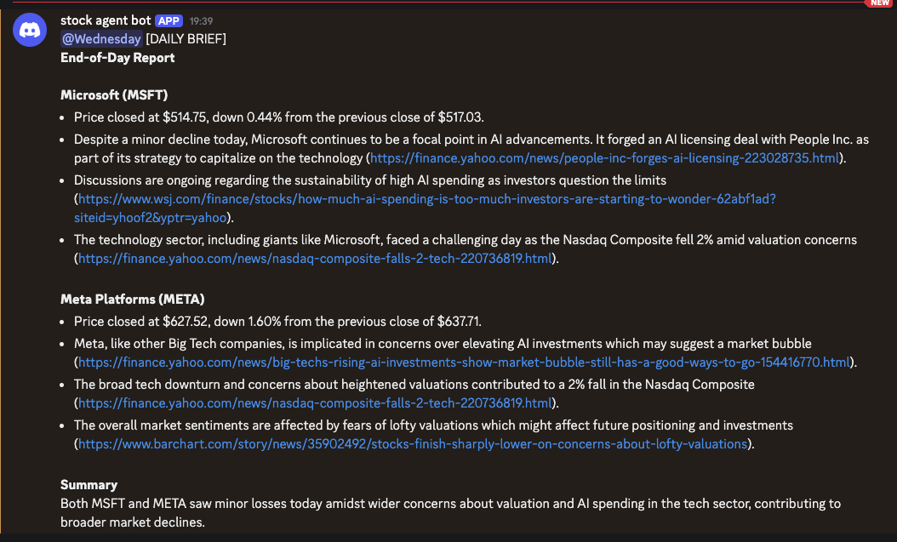

# Stock Monitor Agent 

A LangGraph-powered stock monitoring system that trace stock price, 
collect news and generate reports with workflow mode and agent mode.


### Workflow Mode
- Parses user requirements with LLMs
- Fetches live prices and news via yfinance, keeping only stories actually about each ticker, with article summaries
- Compares each move with the market (SPY / QQQ) so the brief can tell stock-specific moves from market-wide ones
- Adds relative volume (today vs the usual volume by this time of day), recent SEC 8-K / 6-K filings with the
  opening of their EX-99.1 press release, and the next earnings date (facts), plus analyst consensus, price targets,
  EPS estimates and recent rating changes (opinions); the brief keeps facts and analyst views in separate sections
- Judges price movement thresholds
- Summarizes results using LLMs
- Sends notifications to Discord or console

Topology: 


### Agent Mode

- LLM agent parses user prompt itself
- LLM agent make use of tools provided to finish works from user requirements
- LLM agent decides when to end

Topology:




## Example

User prompt:

```
Check MSFT and META price and give me English report in discord
```

Result:

---

## Setup

### 1. Install dependencies
```bash
pip install -r requirements.txt
```

### 2. Add your API key
Create a `.env` file in the project root with your [OpenRouter](https://openrouter.ai) key:
```
OPENROUTER_API_KEY=sk-or-your-key-here
# optional, defaults to minimax/minimax-m3.1-flash:free
LLM_MODEL=minimax/minimax-m3.1-flash:free
```

### 3. Configure Discord (optional)
Create a `config.yaml`:
```yaml
discord:
  webhook_url: "https://discord.com/api/webhooks/xxxx/xxxx"
  mention_id: "xxxxxxxx"
```

### 4. Configure SEC EDGAR (optional)
SEC requires automated clients to identify themselves with a contact. Without it, filings are skipped.
Add to `config.yaml` (or set the `SEC_USER_AGENT` environment variable):
```yaml
sec:
  user_agent: "Your Name your-email@example.com"
```

---

## Usage

### Use Workflow Mode
Pass the requirement on the command line. The monitor keeps running and checks on the schedule in your requirement; stop it with Ctrl+C:
```bash
python main_workflow.py "Every 10 minutes check MSFT and NVDA, alert me in discord if they move more than 3%"
```

Run a single check right now and exit:
```bash
python main_workflow.py --once "Check MSFT and META price and give me English report in discord"
```

Scheduling (market timezone defaults to `America/Toronto`; runs on NYSE trading days only, skipping weekends and NYSE holidays, though early closes such as the day after Thanksgiving are not handled):
- **daily** (default): runs once per trading day at `schedule_time` (e.g. "after market close" → 16:30) and always sends the brief.
- **interval** ("every N minutes"): checks every N minutes from 09:30 open, plus once at 16:00 close.
  It stays quiet unless a new alert fires, then sends one `[INTRADAY ALERT]` message with the alert and a brief
  covering only the tickers that triggered.

Alert dedup: a ticker alerts once per day per direction, and again only when its move crosses the next
multiple of the threshold (with 5%: at 5%, then 10%, ...). State lives in `state/alerts.json`, so restarts don't re-alert. An alert is recorded only after it was delivered,
so a failed Discord send is retried on the next check.


### Use Agent Mode

Run the main entry:
```bash
python main_agent.py
```

Example prompt (inside `main_agent.py`):
```python
init = {
    "requirement": "分析 MSFT, NVDA 和 META, 并在discord给我发简报"
}
```


---

## Project Structure
```
main_workflow.py    # LangGraph workflow definition and monitor CLI
monitor.py          # Scheduling (daily / interval) and alert dedup store
main_agent.py       # LangGraph agent definition
core.py             # Shared logic for both modes: prices, context, brief, config
parser.py           # Parse natural language into structured rules
ticker_checker.py   # Fetch stock prices, compute change and relative volume
news_collector.py   # Recent, relevance-filtered news with article summaries
analyst.py          # Analyst consensus, price targets, rating changes, earnings date (yfinance)
filings.py          # Recent SEC 8-K / 6-K filings and their press releases (EDGAR)
llm_interaction.py  # Interface with LLMs via OpenRouter (OpenAI-compatible API)
notifier.py         # Send Discord or console notifications
tests/              # pytest unit tests
```

---

## Acknowledgements
- [LangGraph](https://python.langchain.com/docs/langgraph)
- [yfinance](https://github.com/ranaroussi/yfinance)
- [OpenRouter](https://openrouter.ai)

---

## License
Apache 2.0

